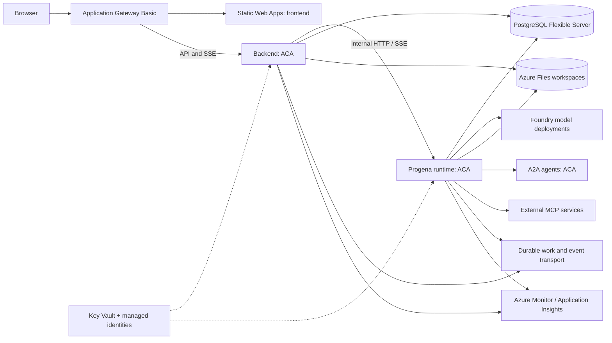

# Azure target state for Progena

Status: proposed demo architecture, 30 October 2026. This is a design for review, not a deployment plan or a claim that the current application is horizontally scalable. Validate service availability, preview status, quotas, pricing and networking in the chosen subscription and region before implementation.

## Recommendation

Use **Azure Static Web Apps** for the built frontend, **Application Gateway Basic** for same-origin path routing, and **Azure Container Apps (ACA)** for the FastAPI backend and Progena runtime; **Azure Database for PostgreSQL Flexible Server** for the existing databases and pgvector; and **Microsoft Foundry models** for inference. Preserve Progena's LangGraph orchestration, checkpoint serializer, domain stores and browser contracts. Use Azure Files for persistent worktrees. Defer dynamic sessions and their execution broker; shell execution is optional for the demo. Authenticate users from the home and other approved Entra tenants, with backend authorization. Treat Foundry hosted agents as a focused experiment for individual agents, not a prerequisite for hosting the entire application. Use Functions Flex Consumption only for discrete, event-driven workloads if those are extracted later.

Start with a single active backend and runtime replica, with minimum replicas of one, while explicitly resolving process-local streams, work execution and scheduler ownership. This is a controlled initial production shape, not high availability. The target is horizontally scalable services backed by durable events and work dispatch, with an independently isolated execution plane. Do not declare HA merely by increasing replica counts.

Assumptions to confirm: approved users across Entra tenants; one primary Azure region; low traffic; A2A agents within the Container Apps environment and external integrations when authorized; existing Postgres data and user-facing behavior must survive migration. Region, budget, residency, RPO/RTO, concurrency, tenant boundaries and model choices remain decisions for the owner.

## Existing system and implications

| Current capability | Evidence | Azure implication |
| --- | --- | --- |
| React/Vite frontend, FastAPI backend, separate LangGraph/DeepAgent runtime | [Architecture](ARCHITECTURE_DIAGRAM.md), [Compose](../docker/docker-compose.progena.yml) | Deploy independently; preserve internal backend-to-runtime HTTP/SSE and browser routing. |
| Browser commands return 202 and use canonical UI SSE plus request-scoped chat SSE | [Backend contract](BACKEND.md), [architecture](ARCHITECTURE_DIAGRAM.md) | Proxy must preserve SSE, flushing, correlation and reconnect semantics; don't replace responses with synchronous payloads. |
| Canonical replay buffer and chat content state are in memory; execution uses background tasks | [Architecture](ARCHITECTURE_DIAGRAM.md), [responses.py](../src/backend/chat/responses.py), [async subagents](../src/progena/async_subagents/protocol.py) | Requests and streams can land on different replicas; restarts lose transient frames and active tasks. Sticky sessions alone do not provide durability. |
| Postgres stores configuration, state, checkpoints and logs; pgvector supports knowledge | [State documents](STATE_DOCUMENTS.md), [local startup](LOCAL_STARTUP.md) | Use managed PostgreSQL, preserve separate runtime/backend databases, LISTEN/NOTIFY, checkpoint serialization, migrations and extension support. |
| Scheduler, asynchronous agents and thread-scoped coordination | [Architecture](ARCHITECTURE_DIAGRAM.md), [runtime settings](../.env.example) | Verify durable claiming, recovery and single scheduler ownership across replicas; retain per-thread advisory locks and human resume semantics. |
| Runtime executes shell commands with persistent scratch, repository and shared mounts; optional ACP and external A2A agents | [Compose](../docker/docker-compose.progena.yml), [local startup](LOCAL_STARTUP.md) | Shells, worktrees, credentials and shared files need explicit isolation and persistence design; container-local files cannot be assumed durable or shared. |
| Host nginx currently handles public TLS and authentication | [Compose](../docker/docker-compose.progena.yml) | Azure ingress must replace that boundary; don't assume application routes enforce user or tenant authorization. |
| Provider profiles and encrypted credentials are stored in Postgres; Azure key/base URL supported | [.env.example](../.env.example) | Foundry integration can start with existing provider support; managed identity requires code and token refresh validation rather than assuming it already works. |

## Target topology

Durable transport is a future capability, not part of the initial demo. Dynamic sessions and an execution broker are deferred. The checked-in nginx configuration currently serves static files and proxies API routes; replace those functions with static hosting and gateway routing, preserving unbuffered streaming. Initially the backend and runtime can run one active replica each while those changes are made. Host the static frontend in Azure Static Web Apps and route the public origin through Application Gateway Basic: static paths to the frontend and /api/* and /v1/* to the ACA backend. Keep the runtime internal. Validate gateway-to-origin access, host headers, SPA fallback and backend ingress visibility. Basic is a preview SKU and does not provide WAF or Private Link; explicitly design authentication and prevent direct backend bypass. Verify every proxy hop, including the gateway and ACA ingress. Microsoft documents disabling response buffering for SSE on Application Gateway, but its buffer configuration documentation names Standard v2; confirm support on Basic before relying on it. The design must not expose the runtime or backend as an unauthenticated bypass around the edge.

## Hosting and streaming

ACA fits the existing container images, internal service discovery and independent resource sizing. Use separate ACA apps for backend and runtime, and a static frontend deployment; pin image digests, configure startup/readiness/liveness probes, and ensure graceful termination. `/healthz` is liveness, not evidence that Postgres, runtime, queues or models are ready; implement suitable readiness checks without turning a temporary dependency failure into a restart loop. Review the frontend image's Node 20 build stage against the repository's Node 24 requirement.

ACA documents a **240-second HTTP request timeout**. The app's SSE connections and backend-to-runtime streams can outlive that limit, so prove the behavior end to end under both active and idle streams before accepting ACA ingress. Microsoft also describes a four-minute idle timeout for premium ingress; the documentation does not clearly establish whether active SSE is subject to an additional absolute limit. Test heartbeats and silent streams rather than assuming either behavior. Exercise reconnect and `Last-Event-ID`, expired cursors, interruption during a model response, and browser resynchronization across all hops. If required semantics cannot be achieved, use an ingress/hosting path that demonstrably supports them, or implement bounded streams with reconnect and durable replay. Do not switch protocols without preserving the browser contract. [ACA ingress](https://learn.microsoft.com/en-us/azure/container-apps/ingress-overview).

For scale-out, implement a shared event distribution and replay mechanism with stable ordering and bounded retention, plus recovery from missed events via existing correlated snapshots. Persist or reconstruct request-scoped content when lossless continuation is required; otherwise explicitly surface resync and recover from checkpoints. Ensure a command accepted on one replica reaches subscribers on another and subscriptions remain scoped to the right user and run. A shared broker alone does not make existing in-memory buffers durable. Load-test multiple replicas, reconnects and rolling revisions before raising minimum or maximum replicas.

Move accepted long-running work out of untracked process-local tasks into a durable queue/worker model, such as Azure Service Bus plus ACA workers, with idempotency keys, leases, bounded retries, dead-letter handling and observable terminal states. Acknowledge only after durable acceptance and preserve event ordering. Specify recovery for in-flight model/tool calls, cancellation, human interrupts and partial side effects; external operations may be at-least-once, not magically exactly-once. The scheduler tick runs inside the runtime heartbeat; existing background-task advisory locks protect specific state updates but do not by themselves establish scheduler leadership. Establish scheduler ownership through a database lease/claim protocol or a dedicated singleton worker with tested failover; review dispatch atomicity before choosing. Test Postgres advisory locks with pooled connections and release on failure. Prevent duplicate Telegram pollers and other background integrations during replica or revision overlap.

## Data and storage

Use private PostgreSQL Flexible Server with TLS, managed backups, an HA option appropriate to the agreed RPO/RTO, and an explicit restore drill. Provision `progena` and `backend` databases and roles through migrations rather than relying on privileged application startup to create databases. Validate `vector` extension allowlisting/version and permissions, checkpoint schema, existing `LISTEN/NOTIFY`, connection limits and failover behavior in a representative server. Use direct/session-compatible connections for listeners and session-level advisory locks; validate any pooler mode rather than assuming transaction pooling preserves connection state. Budget connections across every replica and worker. Preserve `CheckpointSerializer` and historical checkpoint aliases.

Keep existing database-backed documents and checkpoints authoritative. Classify attachment blobs, logs, ACP captures, worktrees, shell scratch and `/shared` separately: determine retention, size and access requirements before moving any. The demo does not require Blob Storage: existing application documents, attachments and checkpoints remain in Postgres where already supported, and sandbox scratch is disposable. Blob Storage was proposed only for durable files and exports from ephemeral execution sessions; add it later if those files must survive session destruction. Any such integration requires application adapters and is not a transparent filesystem replacement. For the demo, mount an Azure Files classic file share into the regular Container Apps that need persistent workspaces and shared files. Use replica-scoped EmptyDir for disposable scratch. Test Git worktrees, permissions, locking and concurrent access against the selected SMB or NFS share; network filesystem semantics are not assumed equivalent to local disk. Azure Files is backed by an Azure Storage account and incurs storage costs. Direct Azure Files mounts in dynamic sessions remain unverified and outside the initial demo. [ACA storage mounts](https://learn.microsoft.com/azure/container-apps/storage-mounts). Do not store runtime scratch or secrets in container layers. Specify backup, restore, encryption-key recovery, retention and data deletion together.

## Model and agent choices

Use a Foundry project and model deployments as the initial model endpoint, selecting models and regions based on capability, quota, residency, availability and cost. Map each configured provider profile to its deployment and retain non-Azure providers where needed. Use managed identity and least-privilege model roles where supported, but first implement and test token acquisition/refresh in the actual LangChain/OpenAI integration; until then use a Key Vault-backed credential with rotation. Never assume a deployment name identifies the underlying model or price. Record prompt, completion, cached tokens, retries, latency and model deployment per request without logging secrets or sensitive content by default.

Foundry hosted agents support LangGraph and Responses/Invocations protocols and provide per-session sandboxing and lifecycle management. They are attractive for independently deployable specialist agents, but Progena's always-on scheduler, internal HTTP/SSE, custom tools, shared filesystem, checkpoint ownership and external integrations do not automatically map to their per-session model. Prototype a bounded specialist agent, verify streaming/resume and thread identity, Postgres connectivity, tool access, sandbox persistence, networking, timeouts, observability and costs; retain Progena as orchestration and system of record unless that proof demonstrates parity. Review current feature status and contractual suitability. Network isolation must be designed at Foundry account creation. [Hosted agents](https://learn.microsoft.com/azure/foundry/agents/concepts/hosted-agents), [LangGraph hosting](https://learn.microsoft.com/en-us/azure/foundry/how-to/develop/langchain-hosted-agents), [Foundry networking](https://learn.microsoft.com/azure/foundry/agents/concepts/networking-options).

## Shell execution

Dynamic sessions and an execution broker are deferred. Shell functionality is optional; disable shell-enabled tools in the initial demo unless explicitly needed. Existing shell execution runs inside the runtime with access to its environment and mounted worktrees, so enabling it requires a deliberate trust decision, narrowly scoped credentials and limits. Test Azure Files worktree persistence and Git semantics independently of shell isolation. If isolated execution is later needed, prototype dynamic sessions and determine how files are staged and exported. [Dynamic sessions](https://learn.microsoft.com/azure/container-apps/sessions).

## Functions Flex Consumption

Flex Consumption is useful for extracted event-triggered, bounded operations such as document processing or notifications when a Function programming model and separate deployment are worthwhile. It supports scale to zero and VNet integration, but HTTP-triggered functions have a documented 230-second response limit and platform termination remains possible even with an unbounded function timeout. It is therefore not the default host for Progena's persistent runtime, SSE gateway or scheduler. Durable Functions would be a separate orchestration redesign, not a drop-in LangGraph checkpoint replacement. [Functions hosting limits](https://learn.microsoft.com/en-us/azure/azure-functions/functions-scale), [Flex Consumption](https://learn.microsoft.com/en-us/azure/azure-functions/flex-consumption-plan).

## Security, operations and delivery

- Authenticate users with Microsoft Entra ID across the home and approved external tenants. Evaluate a multitenant registration and ACA backend authentication; enforce an explicit tenant/user allowlist and application authorization for every HTTP request, SSE subscription, artifact and tool action. Verify browser login, redirects, cookies, SSE reconnects and direct backend access through the gateway. Static Web Apps Free custom identity registrations are unavailable; its login does not automatically protect the separate API. Decide tenant isolation explicitly; a login proxy alone does not supply row-level authorization. Protect cookies, CSRF and CORS; validate forwarded headers only from trusted proxies.
- Use distinct managed identities for backend, runtime and any future workers; scope RBAC to individual resources. Store the existing provider encryption key and unavoidable secrets in Key Vault, restrict access, and document rotation and recovery. Use private networking/DNS for Postgres and other supported services, and explicitly govern outbound internet access. Review all external agents and MCP servers as separate trust boundaries.
- Send structured logs, traces and metrics to Azure Monitor/Application Insights with request, operation, thread and run correlation; avoid prompt, token, secret and session-ID leakage. Alert on readiness, stream reconnect/resync, queue age/dead letters, scheduler lag, checkpoint failures, Postgres connections, sandbox failures, model errors and spend. Establish retention and access policies.
- Build and scan images in CI, push immutable images to ACR, deploy through reviewed infrastructure as code and separate dev/test/prod environments. Use workload identity federation for CI, least privilege and protected deployment environments. Run migrations as an explicit controlled step; test rollback compatibility and restore before rollout. Existing repository rules prohibit deployment without explicit instruction.

## Delivery sequence and acceptance gates

1. **Baseline and proof:** inventory providers, shell operations, data sizes, integrations and scheduler behavior; choose region, SLOs and identity boundary. Run existing containers against disposable Flexible Server with vector; validate backups, migration, LISTEN/NOTIFY and checkpoint restore. Measure model latency and baseline costs.
2. **Demo application landing zone:** deploy the static frontend and two ACA services with one active backend/runtime, managed Postgres and Foundry inference. Add real auth, secrets and monitoring. Test all browser contracts, internal connectivity, reconnect and long-lived streams through actual Azure ingress. This stage is not HA and has interruption risk.
3. **Persistent worktrees:** mount an Azure Files classic share, validate Git worktrees and permissions across restart, and test backup and restore. Keep optional shell tools disabled until their trust boundary is accepted.
4. **Durability and scale:** implement durable work dispatch and cross-replica event/replay, scheduler ownership and integration leader election. Test two or more replicas, rolling deployment during active work, failure injection, duplicate delivery, advisory locks, human resume and cross-user isolation. Only then enable scale-out and set availability objectives.
5. **Optional platform experiments:** benchmark a Foundry hosted specialist and a Flex event worker against ACA equivalents for operational complexity, limits and cost. Adopt only after contract and security parity are demonstrated.

## Cost and decisions

No credible monthly estimate is possible without region, uptime, replica size, concurrent users/sessions, tokens, storage, retention and HA requirements. Model separately: Application Gateway Basic fixed and capacity charges, static hosting, ACA compute and ingress, Postgres compute/storage/HA/backups, Foundry input/output tokens and capacity, Azure Files capacity and transactions, optional artifact storage, Service Bus, logs, networking and egress. Compare a low-traffic single-replica baseline with the resilient scaled target using the Azure pricing calculator and measured usage; set budgets and alerts. Warm instances and session pools can cost money while idle.

Decide before implementation: region and data residency; public versus private access; identity and tenant model; acceptable RPO/RTO; concurrency and maximum run duration; allowed tools and outbound destinations; artifact persistence; model quotas and budget; and whether hosted-agent preview features are acceptable. No Azure resources have been provisioned by this design.

Application Gateway Basic is preview. Verify whether Basic supports disabling response buffering, then configure an SSE-appropriate backend timeout; test active and idle streams across both the gateway and ACA ingress. Do not use the Static Web Apps linked API proxy for SSE: its documented API request limit is 45 seconds. Validate SPA fallback, origin host headers, login cookies and backend access restrictions before adopting this topology. [Gateway SSE](https://learn.microsoft.com/azure/application-gateway/use-server-sent-events); [Static Web Apps API constraints](https://learn.microsoft.com/azure/static-web-apps/apis-overview).

